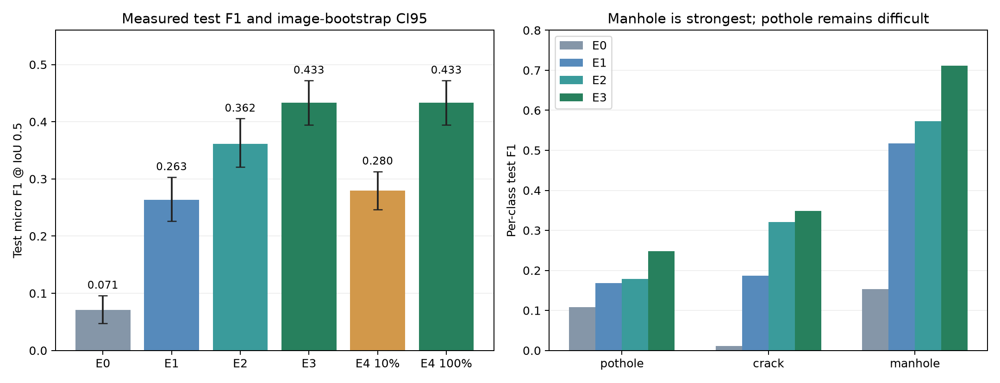

# Báo cáo Lab Day 10 — kết quả E0–E4

Họ tên: **Nguyễn Thị Thùy Dương**

`dataset_version`: **d10-21e4070301**

Cập nhật: **14/10/2026**. Nguồn: [Kaggle Version 2](https://www.kaggle.com/code/ntthduong/day10-qwen3vl-thuyduong-full-bonus/notebook), session `358072033`.

## Phạm vi và nguồn bằng chứng

E0–E4 đã có kết quả test đầy đủ, không thiếu dự đoán. E1/E2/E3/E4 10% đều hoàn tất 300 bước. E3 được chọn bằng validation và đạt F1 test **0.4332**. Bonus E5 dừng ở bước 18/60 khi callback ghi log chứa NaN; chưa có kết quả test E5.

Các file `report/evidence/*.json`, `report/runs/*.json`, `selection.json`, `e4_design.json`, `execution_plan.json` và `data_audit.json` được phục hồi từ phần xem JSON của Output Kaggle. Nội dung 14 file gốc đã được đối chiếu fingerprint JSON chuẩn hoá và khớp toàn bộ; không tự sinh lại điểm từ số log đã làm tròn. Nguồn và giới hạn truy xuất nằm trong [kaggle_provenance.json](report/kaggle_provenance.json).

Kaggle không tải file được do dịch vụ reCAPTCHA và chỉ cho xem một mục trong preview JSONL bị cắt ngắn. Vì vậy bản này có bảng kết quả, phân tích và biểu đồ đầy đủ từ evidence, nhưng **chưa có sáu ảnh dự đoán kèm GT, F1 khi chấm sai tọa độ trên toàn tập, hoặc CI ghép cặp theo phiên**. Những mục đó cần raw predictions, split và ảnh đầy đủ; không dùng số hay ảnh giả để thay thế. Đây chưa phải xác nhận đạt trọn rubric hoặc bonus.

## Bảng tổng hợp kết quả thực nghiệm

| Setup | Tham số học | VRAM đỉnh (GiB) | Train (phút) | F1 test | CI95 | FP/ảnh | F1 pothole | F1 crack | F1 manhole |
|---|---:|---:|---:|---:|---|---:|---:|---:|---:|
| E0 | 0 | — | — | 0.0706 | [0.0476, 0.0962] | 1.113 | 0.1081 | 0.0117 | 0.1533 |
| E1 | 33,030,144 | 5.144 | 53.89 | 0.2635 | [0.2262, 0.3033] | 1.177 | 0.1685 | 0.1871 | 0.5171 |
| E2 | 142,135,296 | 6.804 | 59.86 | 0.3616 | [0.3210, 0.4057] | 0.981 | 0.1789 | 0.3208 | 0.5724 |
| E3 | 148,426,752 | 6.941 | 64.26 | 0.4332 | [0.3943, 0.4722] | 0.765 | 0.2486 | 0.3486 | 0.7119 |
| E4 10% | 148,426,752 | 6.822 | 68.20 | 0.2799 | [0.2462, 0.3132] | 1.781 | 0.2057 | 0.1897 | 0.5449 |
| E4 100% | 148,426,752 | 6.941 | 64.26 | 0.4332 | [0.3943, 0.4722] | 0.765 | 0.2486 | 0.3486 | 0.7119 |

E0 không huấn luyện; dấu “—” là không áp dụng cho tài nguyên train, không phải tài nguyên inference bằng 0. VRAM là peak CUDA memory allocated, đơn vị GiB (bytes/2³⁰). Thời gian là wall-clock vòng train, không gồm tải model hay inference. E0–E3 chạy trên hai GPU riêng nhưng dùng chung CPU; không suy ra chênh lệch tốc độ thuần từ số phút. E4 100% tái sử dụng đúng E3, không phải một lần chạy độc lập.



| Setup | F1 validation dùng chọn baseline |
|---|---:|
| E0 | 0.0388 |
| E1 | 0.1818 |
| E2 | 0.2842 |
| E3 | 0.3457 |

Tiêu chí: F1 trên toàn bộ validation cao nhất, hoà điểm chọn ít tham số học hơn. Chọn trong E1–E3; E0 là đối chứng zero-shot. Không chọn setup bằng test.

| Setup | JSON hợp lệ | Precision | Recall | TP | FP | FN | Mean IoU của TP |
|---|---:|---:|---:|---:|---:|---:|---:|
| E0 | 72.3473% | 0.0895 | 0.0583 | 34 | 346 | 549 | 0.6185 |
| E1 | 99.3569% | 0.2824 | 0.2470 | 144 | 366 | 439 | 0.6745 |
| E2 | 100.0000% | 0.3912 | 0.3362 | 196 | 305 | 387 | 0.6627 |
| E3 | 100.0000% | 0.4882 | 0.3894 | 227 | 238 | 356 | 0.6922 |
| E4 10% | 99.3569% | 0.2503 | 0.3173 | 185 | 554 | 398 | 0.6719 |
| E4 100% | 100.0000% | 0.4882 | 0.3894 | 227 | 238 | 356 | 0.6922 |

Mean IoU chỉ tính trên các box đã ghép đúng; không dùng con số này để thay cho recall/F1. Ví dụ E0 có mean IoU 0,6185 nhưng chỉ tìm đúng 34/583 GT.

## Cấu hình thực tế

Model `Qwen/Qwen3-VL-4B-Instruct`; LLM NF4 4-bit/double quantization, visual và lm_head không lượng tử hoá. LoRA r=16, alpha=32, dropout=0,05; AdamW LR=0,0002, warmup 5%, cosine, clipping 1,0. SFT dùng batch 1 × accumulation 8, seed=42, 300 optimizer steps. Suy luận greedy, batch 16, tối đa 512 tokens, tọa độ `norm1000` cho mọi setup. Cấu hình in ở các cell giới thiệu còn batch 2 × 4 hoặc E0 256 tokens; cấu hình run đã thực thi trong `report/configs/` mới là nguồn đối chiếu.

GPU Tesla T4 x2; E0/E2 trên GPU 0, E1/E3 trên GPU 1; E4 chạy sau khi chọn baseline. Runtime ghi Torch 2.11.0+cu128, Transformers 5.19.0, PEFT 0.21.2, TRL 1.9.2, Accelerate 1.15.0, bitsandbytes 0.50.2. `model_revision` trong run là null nên không khẳng định đã lưu hash revision model.

| Run | Ảnh train thực dùng | Bước hoàn tất | Loss tại bước 300 |
|---|---:|---:|---:|
| E1 | 1422 | 300 | 0.542276 |
| E2 | 1422 | 300 | 0.523257 |
| E3 | 1422 | 300 | 0.527570 |
| E4_DATA_SIZE_0.1 | 142 | 300 | 0.014062 |

Loss trên là từng giá trị log tại bước cuối, không phải trung bình toàn bộ train hay validation loss. Bốn dòng log gốc được lưu trong [observed_final_steps.json](report/observed_final_steps.json); chưa có toàn bộ training log local để vẽ learning curve.

## 10 câu hỏi

### Câu 1 — Kiến trúc và phần được cập nhật

Đếm từ hình dạng tensor gốc: ViT không gồm projector **306.242.560** tham số; projector **109.105.152**; LLM + head **4.022.468.096**; tổng **4.437.815.808**. Đây là số phần tử tensor trước khi tính cách lưu packed 4-bit.

E1 học 252 module LoRA của LLM, với **33.030.144** tham số; ViT và projector đóng băng. E2 thêm toàn bộ `visual.merger` và `visual.deepstack_merger_list`, lên **142.135.296** tham số. E3 thêm 96 module LoRA attention/MLP của ViT, tổng 348 module và **148.426.752** tham số. E2−E1 đúng 109.105.152 tham số projector; E3−E2 thêm 6.291.456 tham số LoRA ViT. Metadata chi tiết nằm trong `report/runs/`.

### Câu 2 — E0: parse và lỗi quan sát được

E0 có `parse_valid_rate` **0.723473**, tức 225/311 ảnh hợp lệ và **86 ảnh không parse được**. Từ scorer quan sát hai vấn đề lớn: bỏ sót GT (FN=549, recall=0,0583) và dự đoán không ghép được GT cùng lớp ở IoU≥0,5 (FP=346, tương đương 1,113 FP/ảnh). Lỗi parse là vấn đề bổ sung đáng kể. Không thể tách FP thành sai lớp, sai vị trí hay hallucination chỉ bằng thống kê tổng hợp.

Mẫu output thô thật tại ảnh `vlcsnap-00200`, lấy từ preview `checkpoints/e0_test.jsonl`:

```json
[{"label":"manhole","bbox_2d": [770, 640, 843, 687]}, {"label":"manhole","bbox_2d": [909, 786, 997, 824]}]
```

Mẫu này parse được và có hai box manhole. Chưa có GT của ảnh trong local nên không gán nó là ví dụ đúng/sai. E0 kém nhất ở crack: chỉ 3 TP/299 GT, F1=0,0117; pothole 8 TP/121 GT; manhole 23 TP/163 GT.

### Câu 3 — Thang 0–1000 và kiểm chứng

Nhãn và prediction dùng xyxy chuẩn hoá riêng theo chiều rộng/cao. YOLO `(xc,yc,w,h)=(0,5;0,5;0,2;0,2)` trở thành `[400,400,600,600]`; ở ảnh 640×360, box pixel tương ứng `[256,144,384,216]`.

Nếu chấm `[400,400,600,600]` như pixel, scorer nhân x với 1000/640 và y với 1000/360: box trở thành `[625,1111,1117,1667]` (làm tròn ở đây), không khớp GT trên. Kiểm chứng riêng bằng scorer gốc trên một mẫu tổng hợp cho F1 đúng thang=1,0 và sai thang=0,0; kết quả minh hoạ nằm trong `report/coordinate_demo.json` và **không phải evidence E0–E4**. F1 test thực của E3 khi chấm đúng là 0.4332; chưa đo F1 E3 khi cố ý chấm pixel vì cần toàn bộ raw predictions.

### Câu 4 — Mask loss

Chỉ answer của assistant và token kết thúc nhận nhãn; prompt, token ảnh và padding có label=-100. Hàm encode kiểm tra prompt là tiền tố chính xác của chuỗi đầy đủ rồi mới mask, tránh lệch vị trí khi áp chat template.

Audit mẫu train `20250216_164325` ghi **220 token ảnh và 250 token assistant**, có JSON nhãn và `<|im_end|>` trong `supervised_text`. Với E4 subset, mẫu `20250219_164649` có 220 token ảnh và 59 token assistant. Nếu tính loss cả prompt/token ảnh thì mục tiêu bao gồm tái tạo phần đầu vào, làm thay đổi phân bổ gradient; không còn chỉ tối ưu sinh nhãn. Padding không mask còn gây thiên lệch token pad. Chưa chạy ablation bỏ mask, nên không gán mức giảm F1 bằng số.

### Câu 5 — Projector và precision

Trọng số packed 4-bit không phù hợp để cập nhật đầy đủ bằng AdamW như tham số float. Do đó pipeline loại toàn bộ visual khỏi lượng tử hoá, rồi mở gradient projector ở E2/E3. ViT đóng băng trong E2 không ngăn backprop vào projector float; điều cần tránh là cố full-tune projector bị quantize hoặc chặn gradient của phần cần học.

Projector và LoRA có master weights float32; forward dùng autocast fp16, phù hợp AdamW/GradScaler trên T4. Float32 là lựa chọn của pipeline này, không phải quy luật bắt buộc trên mọi phần cứng. Projector được lưu riêng và nạp lại cùng adapter trước inference. Tài nguyên tăng từ 5,144 GiB (E1) lên 6,804 GiB (E2) rồi 6,941 GiB (E3).

### Câu 6 — Split theo phiên quay

Frame gần nhau có nội dung tương tự; chia ảnh ngẫu nhiên có thể đưa cảnh gần trùng vào train/test, làm kết quả lạc quan. Audit ghi **18 phiên trên toàn dataset**, `session_leakage=false`, cùng dataset version. Số 18 không phải số phiên riêng của test.

| Split | Ảnh | Box pothole | Box crack | Box manhole |
|---|---:|---:|---:|---:|
| Train | 1.422 | 1.074 | 1.750 | 691 |
| Validation | 276 | 66 | 470 | 103 |
| Test | 311 | 121 | 299 | 163 |

Có một nhãn crack cao bằng 0 tại ảnh train `vlcsnap-00058`. Chỉ bỏ nhãn đó khỏi target huấn luyện; split, số box gốc và GT chấm điểm giữ nguyên. E4 dùng đúng 142 ảnh train (10% lấy nguyên theo quy tắc subset), còn baseline dùng 1.422 ảnh.

### Câu 7 — E1/E2/E3 có đáng mở thêm khối không?

E1 hơn E0 **0.1929 F1**, vượt ngưỡng +0,10 của rubric; JSON hợp lệ 99.3569%, vượt 95%. E2 hơn E1 **0.0981**, với thêm 109.105.152 tham số học và 1,661 GiB VRAM. E3 hơn E2 **0.0716**, thêm 6.291.456 tham số và 0,136 GiB VRAM. E3 đồng thời có F1 validation cao nhất 0,3457 và giảm FP/ảnh từ 0,981 (E2) xuống 0,765.

Trong lần chạy này E3 là lựa chọn hợp lý về chất lượng/VRAM. Phần tăng E2 rõ nhất ở crack (F1 0,1871→0,3208); E3 cải thiện mạnh manhole (0,5724→0,7119), pothole (0,1789→0,2486), còn crack tăng ít hơn (0,3208→0,3486). E2/E3 có CI riêng chồng nhau, nên chưa kết luận cải thiện có ý nghĩa thống kê khi chưa tính CI của delta ghép cặp. Thời gian 53,89/59,86/64,26 phút phản ánh điều kiện chạy đồng thời; chưa dùng làm benchmark tốc độ.

### Câu 8 — 311 ảnh test và độ tin cậy

E3 có CI95 **[0,3943; 0,4722]**, độ rộng **0.0779** (khoảng 7,79 điểm phần trăm), quanh F1 0,4332. CI của E0/E1/E2 có độ rộng lần lượt 0,0486/0,0771/0,0847. Các CI này do scorer gốc bootstrap theo ảnh, không phải theo phiên.

Frame cùng phiên có tương quan, nên bootstrap ảnh có thể đánh giá thấp bất định. Cần raw prediction và session của từng ảnh để bootstrap ghép cặp theo phiên; bản này chưa có CI đó hay số phiên riêng của test. CI riêng chồng nhau không đủ để kết luận hai setup bằng nhau; CI riêng không chồng cũng không thay thế phép so sánh ghép cặp phù hợp. Một seed và một tập test nhỏ giới hạn khả năng khái quát sang tuyến đường/thành phố khác.

### Câu 9 — Phân tích lỗi theo lớp

Ở E3, pothole có F1 thấp nhất **0,2486**, recall **0,1901**: chỉ tìm đúng 23/121 GT, bỏ sót 98. Crack có 99 TP, 170 FP, 200 FN, F1 **0,3486**; manhole có 105 TP, 27 FP, 58 FN, F1 **0,7119**. Hạn chế chính của pothole là recall; crack còn nhiều cả FP và FN.

Train có 1.074 box pothole, 1.750 crack và 691 manhole; vì vậy không thể giải thích kết quả chỉ bằng số mẫu. Box nhỏ, hình dạng crack dài/mảnh, ánh sáng và độ tương phản là những giả thuyết cần đối chiếu ảnh. Chưa đo diện tích box trung vị hoặc đánh giá trực quan toàn bộ dự đoán; không khẳng định nguyên nhân từ F1 tổng hợp. Biểu đồ trên minh hoạ lỗi theo lớp bằng số, **không thay cho sáu ảnh prediction/GT mà rubric yêu cầu**. Sáu ảnh đó cần được bổ sung sau khi tải raw output và dataset.

### Câu 10 — E4: lượng dữ liệu với ngân sách bước cố định

Đổi duy nhất tỷ lệ dữ liệu train của E3: **142 ảnh (10%)** so với **1.422 ảnh (100%)**; prompt, LoRA, LR, seed, batch và 300 bước giữ nguyên. E4 100% tái dùng đúng baseline E3, được khai báo trong `e4_design.json` và metadata evidence.

F1 test 10% **0.2799**, CI95 **[0,2462; 0,3132]**; 100% **0.4332**, CI95 **[0,3943; 0,4722]**; chênh lệch **0.1533**. FP/ảnh giảm từ **1,781** xuống **0,765**. Pothole recall của 10% lại cao hơn (0,2397 vs 0,1901), nhưng precision thấp hơn nhiều (0,1801 vs 0,3594); không kết luận mọi chỉ số đều tăng với nhiều dữ liệu.

Loss bước cuối của 10% chỉ **0,014062**, thấp hơn E3 **0,527570**, trong khi F1 test kém hơn. Đây là dấu hiệu phù hợp với quá khớp subset, chưa phải chứng minh nguyên nhân duy nhất. 300×8=2.400 lượt ảnh được dùng; tương đương khoảng 16,90 vòng trên 142 ảnh so với 1,69 vòng trên 1.422 ảnh. Thí nghiệm đo ảnh hưởng lượng dữ liệu với số bước cố định, không giữ số epoch cố định. Hai CI ảnh không chồng hỗ trợ mô tả chênh lệch trong lần chạy; chưa có paired session CI hoặc nhiều seed để khẳng định tổng quát.

## Nhìn lại và phần còn lại

Fine-tuning cải thiện cả định dạng và phát hiện: E0→E3 tăng F1 từ 0,0706 lên 0,4332; JSON hợp lệ từ 72,3473% lên 100%. Tuy vậy E3 vẫn bỏ sót 356/583 GT, nhất là crack và pothole. Scorer chấp nhận một số output có markdown/phần dẫn, nên parse hợp lệ không đồng nghĩa tuân thủ tuyệt đối yêu cầu chỉ JSON.

Trước khi coi bài nộp hoàn chỉnh theo rubric, cần tải raw output để bổ sung sáu ảnh đúng/sai có GT, kiểm chứng sai tọa độ trên toàn tập và paired bootstrap theo phiên. Không đưa ground-truth-only images hoặc smoke test vào bằng chứng dự đoán. E5 là phần riêng còn dang dở; lỗi NaN trong log chưa chứng minh loss/gradient NaN. Bản này chưa yêu cầu chạy lại E0–E4 và không báo hoàn tất bonus.
