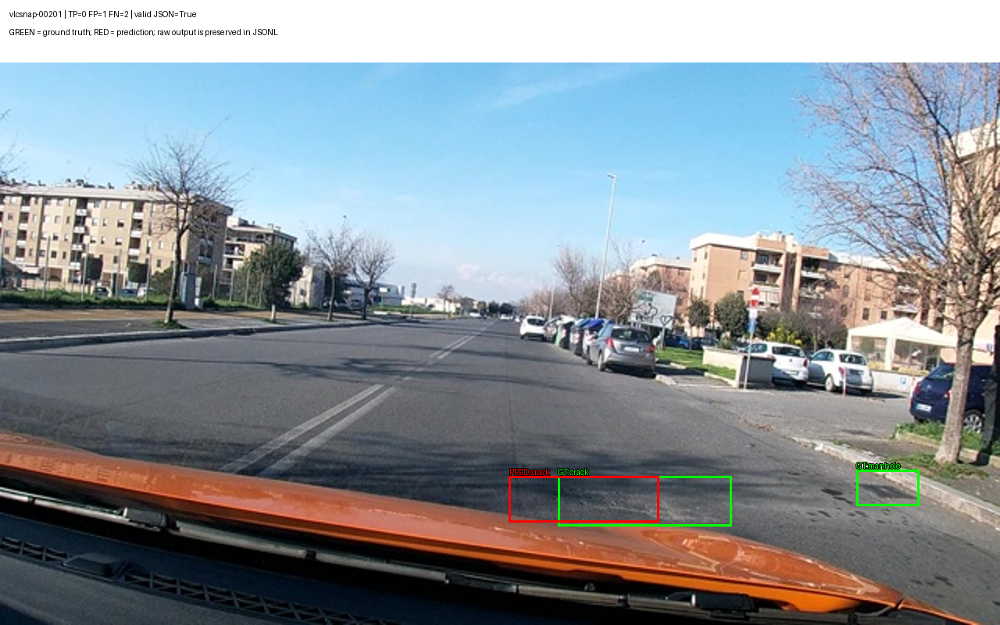
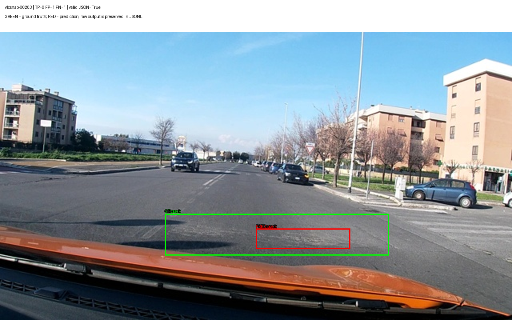
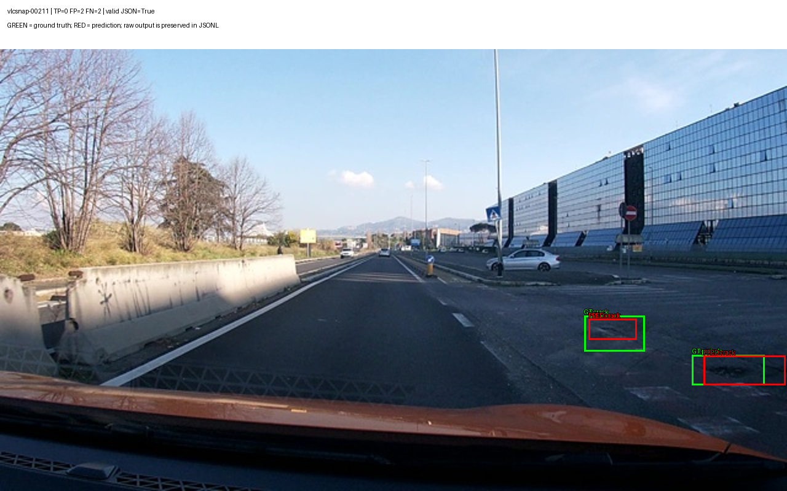
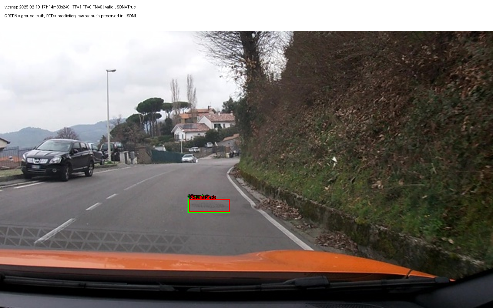
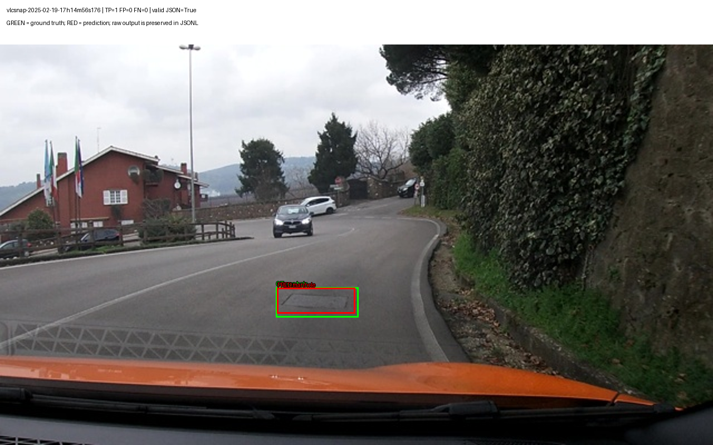
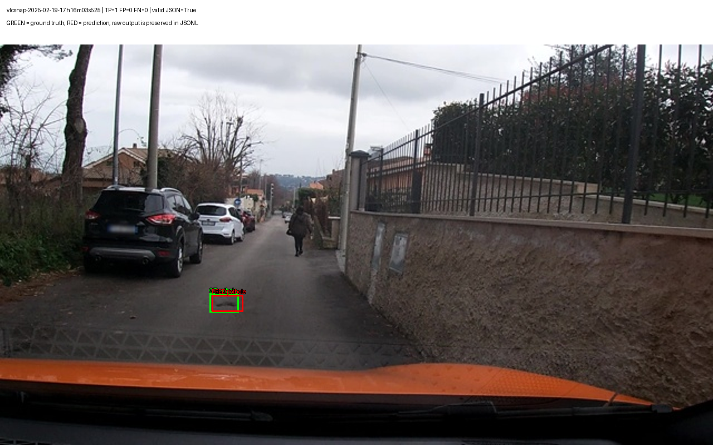
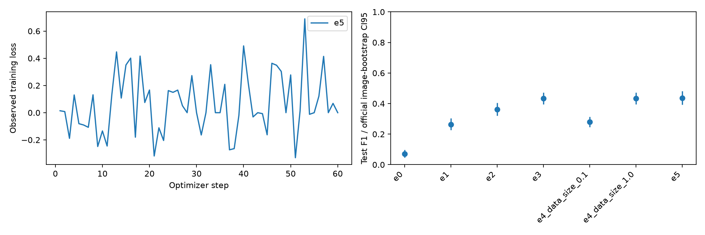

# Báo cáo Lab Day 10 — kết quả E0–E5

Họ tên: Nguyễn Thị Thùy Dương
`dataset_version`: d10-21e4070301

## Phạm vi và nguồn bằng chứng

E0–E4 hoàn tất; E5 GRPO hoàn tất 60 bước, validation 276 ảnh và test 311 ảnh, không thiếu dự đoán test.
Nguồn E0–E4: [Full Bonus Version 2](https://www.kaggle.com/code/ntthduong/day10-qwen3vl-thuyduong-full-bonus/notebook), session `358072033`.
Nguồn E5: [E5 Stable Version 1](https://www.kaggle.com/code/ntthduong/day10-qwen3vl-thuyduong-e5-stable/notebook), session `358221873`, runtime 39 phút 15 giây.
Raw predictions của E0/E1/E2/E3/E4 10%/E5 đã được tải trong ZIP và chấm lại local bằng scorer gốc:
mọi trường điểm, TP/FP/FN, CI95 và parse rate khớp evidence. E4 100% dùng lại raw E3.
Chi tiết nguồn và kiểm chứng ở `report/kaggle_provenance.json`, `report/e5_provenance.json`;
raw test được giữ tại `report/predictions/`. Validation E5 được giữ nguyên từ ZIP; ZIP không chứa raw validation để chấm lại local.

## Bảng tổng hợp kết quả thật

| Mã | Tham số học | VRAM GiB | Phút | F1 | CI95 | FP/ảnh | pothole | crack | manhole |
|---|---:|---:|---:|---:|---|---:|---:|---:|---:|
| E0 | 0 | 0.00 | 0.00 | 0.0706 | [0.0476, 0.0962] | 1.113 | 0.1081 | 0.0117 | 0.1533 |
| E1 | 33030144 | 5.14 | 53.89 | 0.2635 | [0.2262, 0.3033] | 1.177 | 0.1685 | 0.1871 | 0.5171 |
| E2 | 142135296 | 6.80 | 59.86 | 0.3616 | [0.3210, 0.4057] | 0.981 | 0.1789 | 0.3208 | 0.5724 |
| E3 | 148426752 | 6.94 | 64.26 | 0.4332 | [0.3943, 0.4722] | 0.765 | 0.2486 | 0.3486 | 0.7119 |
| E4_data_size_0.1 | 148426752 | 6.82 | 68.20 | 0.2799 | [0.2462, 0.3132] | 1.781 | 0.2057 | 0.1897 | 0.5449 |
| E4_data_size_1.0 | 148426752 | 6.94 | 64.26 | 0.4332 | [0.3943, 0.4722] | 0.765 | 0.2486 | 0.3486 | 0.7119 |
| E5 | 39321600 | 4.34 | 19.68 | 0.4368 | [0.3931, 0.4810] | 0.749 | 0.2551 | 0.3418 | 0.7315 |

E0–E3 chạy đồng thời trên các GPU riêng, cùng dùng CPU; số phút là wall-clock trong điều kiện đó, không dùng để kết luận chênh lệch tốc độ giữa setup.

E0 không huấn luyện nên cột tài nguyên huấn luyện bằng 0. E4 100% tái sử dụng đúng run E3.
VRAM là peak CUDA memory allocated (bytes/2³⁰), không phải tổng bộ nhớ reserved. Số phút E5 cộng phần checkpoint đã lưu và phiên resume thành công; không gồm thời gian các lần chạy thất bại ngoài checkpoint, tải model hoặc suy luận.
Tất cả SFT dùng batch 1 × tích luỹ 8 = batch hiệu dụng 8, 300 bước; suy luận greedy batch 16, tối đa 512 token cho mọi setup.
Chọn E3 bằng F1 trên toàn bộ validation, tiêu chí và số liệu ở `report/selection.json`.
E5 validation F1=0.339721, parse rate=0.996377;
E3 validation F1=0.345722.
E5 là bonus cố định 60 bước; không thay baseline được chọn bằng validation chỉ vì F1 test nhỉnh hơn.

## 10 câu hỏi

### Câu 1 — Kiến trúc và phần được cập nhật
Đếm hình dạng tensor gốc: ViT không gồm projector 306,242,560; projector 109,105,152;
LLM và head 4,022,468,096; tổng 4,437,815,808 tham số.
E1 cập nhật LoRA LLM; E2 thêm toàn bộ merger và DeepStack mergers; E3 thêm LoRA attention/MLP ViT.
Số tham số học thực tế nằm trong bảng. ViT và lm_head giữ fp16; LLM dùng NF4 với double quantization.

### Câu 2 — E0 và lỗi quan sát được
`parse_valid_rate` = 0.7235. Thống kê thực tế: {'invalid_json_images': 86, 'empty_output_images': 2, 'unknown_label_boxes': 0, 'boxes_at_least_half_image': 2, 'mean_test_iou_reward': 0.1813002643245794}.
Lỗi box/lớp được đo bằng FP=346 và FN=549.
FP gồm box không đạt IoU hoặc sai lớp; FN là GT không có dự đoán cùng lớp đạt IoU 0.5.
Đây là mô tả quan sát, không gán lỗi sai thang chỉ dựa vào JSON hợp lệ.

### Câu 3 — Thang tọa độ và kiểm chứng
Nhãn là xyxy theo 0–1000, chuẩn hoá riêng theo chiều rộng/cao nên độc lập độ phân giải.
Chấm cùng output của E3 đúng thang: F1=0.4332;
cố ý chấm là pixel: F1=0.0000. IoU thay đổi vì box bị co giãn sai.
Unit test còn kiểm chứng box YOLO [0.5,0.5,0.2,0.2] → [400,400,600,600] → pixel [256,144,384,216].

### Câu 4 — Mask loss
Chỉ assistant answer và token kết thúc được giám sát; prompt, token ảnh và padding có label=-100.
Kiểm tra prompt là tiền tố chính xác của chuỗi đầy đủ trước khi mask.
Audit một mẫu: 220 token ảnh, 250 token assistant.
Tính loss trên prompt sẽ dành gradient cho phần người dùng thay vì tác vụ sinh nhãn; padding không mask gây bias token pad.
Chuỗi token được giám sát thực tế: `[{"label":"crack","bbox_2d":[430,467,583,506]},{"label":"pothole","bbox_2d":[361,475,414,522]},{"label":"manhole","bbox_2d":[317,481,616,625]},{"label":"pothole","bbox_2d":[583,500,627,614]},{"label":"crack","bbox_2d":[580,508,655,614]},{"label":"pothole","bbox_2d":[259,517,311,572]},{"label":"crack","bbox_2d":[397,628,447,717]},{"label":"crack","bbox_2d":[339,683,398,808]},{"label":"crack","bbox_2d":[158,789,361,994]}]<|im_end|> `.

### Câu 5 — Projector và precision
Trọng số packed 4-bit không phải tham số float có thể tối ưu đầy đủ bằng AdamW. Vì vậy bỏ `visual` khỏi quantization.
Projector và LoRA có master weights float32 để GradScaler unscale gradient hợp lệ; forward vẫn chạy dưới autocast fp16.
Float32 không phải quy luật cho mọi phần cứng: ở đây đó là lựa chọn ổn định cho vòng AdamW/GradScaler trên T4.
Lưu riêng `projector.safetensors`, kiểm tra keys/shapes và nạp lại cùng adapter trước suy luận E2/E3/E5.

### Câu 6 — Chia theo phiên quay
Frame gần nhau có nội dung tương tự. Chia ngẫu nhiên tạo tương quan train/test, có thể làm F1 cao giả.
Audit không có image/session nằm ở hai split; dataset_version khớp mọi evidence.

- train: 1422 ảnh; box {'pothole': 1074, 'crack': 1750, 'manhole': 691}
- val: 276 ảnh; box {'pothole': 66, 'crack': 470, 'manhole': 103}
- test: 311 ảnh; box {'pothole': 121, 'crack': 299, 'manhole': 163}
- Nhãn có diện tích 0 chỉ được bỏ khỏi target SFT/GRPO; split, số box gốc và ground truth chấm điểm giữ nguyên: [{"split": "train", "image_id": "vlcsnap-00058", "annotation": {"label": "crack", "yolo": [0.639062, 0.786111, 0.003125, 0]}}]

### Câu 7 — So sánh E1/E2/E3
Bảng trên ghi F1, CI95, tài nguyên thực tế. Setup được chọn bằng validation là E3.
So sánh độ tin cậy bằng paired bootstrap theo phiên quay (delta=B−A):
{"e1_to_e2": {"n_sessions": 3, "delta_ci95": [0.07770582793709535, 0.12744593452906966], "method": "paired bootstrap by recording session; delta = B - A", "n_boot": 2000}, "e2_to_e3": {"n_sessions": 3, "delta_ci95": [0.06943042251281845, 0.09620721554116551], "method": "paired bootstrap by recording session; delta = B - A", "n_boot": 2000}}.
Nếu CI delta chứa 0, dữ liệu chưa chứng minh cải thiện; nếu toàn bộ CI >0, cải thiện có hỗ trợ từ các phiên test đã quan sát.
Đánh giá chi phí bằng VRAM/thời gian trong bảng; mở projector thêm gradient và optimizer state, E3 thêm backward qua ViT.

### Câu 8 — Độ tin cậy trên tập test nhỏ
Test có 311 ảnh nhưng chỉ 3 phiên quay.
CI chính thức bootstrap theo ảnh; frame cùng phiên tương quan nên CI đó có thể quá lạc quan.
`report/paired_session_bootstrap.json` bổ sung bootstrap theo phiên; số phiên ít cũng giới hạn khả năng khái quát.
Hai CI riêng lẻ chồng nhau không tự chứng minh không có khác biệt; dùng CI của chênh lệch ghép cặp.

### Câu 9 — Lỗi theo lớp
Ở E3, lớp có F1 thấp nhất là pothole: 0.2486.
Diện tích box trung vị trên test (% ảnh): {'pothole': 0.41927008680000005, 'crack': 1.9813205034999999, 'manhole': 0.6688347743}. Số mẫu từng lớp có ở câu 6.
Box nhỏ làm IoU nhạy với sai lệch vài pixel; lượng mẫu và hình dạng nứt có thể góp phần nhưng không đủ chứng minh nguyên nhân.
Sáu hình dưới chọn 3 F1 ảnh thấp nhất và 3 cao nhất, không chỉ chọn ví dụ đẹp.

### Câu 10 — E4
Đổi duy nhất lượng dữ liệu train: 10% và 100% của E3; chọn subset cố định seed=42.
100% dùng lại baseline, các siêu tham số, prompt, thang tọa độ và số bước giữ nguyên.
F1 10%=0.2799; 100%=0.4332.
CI delta: [0.13599517630442143, 0.19446640316205527].
Do giữ 300 bước, 10% được lặp nhiều lần hơn; kết luận đo lượng dữ liệu với ngân sách bước cố định, không phải số epoch cố định.

## Bonus E5 — GRPO và reward hacking
Khởi tạo từ adapter E3, projector SFT giữ cố định; 4 generations, 128 completion tokens, 60 bước, không vLLM.
Chỉ LoRA LLM/ViT tiếp tục học (39,321,600 tham số); projector có trọng số SFT được lưu/nạp riêng nhưng đóng băng.
GRPO LR=5e-6, beta=0, batch 1 × tích luỹ 4, seed=42. Các trường LR/batch/max_steps SFT được kế thừa trong config;
cấu hình GRPO thực thi nằm trong `config.grpo` và `solution/training.py`.
Run resume từ `checkpoints/e5/checkpoint-5`; loss scale fp16 giới hạn 128 sau khi nạp scaler.
Log giữ cả dòng grad_norm=NaN bước 9 của phiên thất bại, rồi các bước chạy lại. Dùng giá trị mới nhất theo step:
đủ 60 bước có loss/grad_norm/reward hữu hạn; các bước resume 6–60 đều ghi optimizer_step_skipped=false, scale=128.
Loss tổng kết do Trainer báo=0.072642; loss bước 60=0 với reward_std=0,
phù hợp advantage trong nhóm bằng 0, không phải dấu hiệu học hoàn hảo. Không so sánh loss GRPO trực tiếp với cross-entropy SFT.
Reward: JSON lỗi=0; GT/pred cùng rỗng=1; còn lại 0.2+0.8×tổng IoU ghép cùng lớp đạt 0.5/max(nGT,nPred,1).
Test reward bao gồm hoàn hảo, JSON lỗi, sai lớp, thừa box, rỗng, nhãn lạ, và box khổng lồ.
Trước GRPO: {'invalid_json_images': 0, 'empty_output_images': 0, 'unknown_label_boxes': 0, 'boxes_at_least_half_image': 0, 'mean_test_iou_reward': 0.4576720141948324}. Sau GRPO: {'invalid_json_images': 0, 'empty_output_images': 0, 'unknown_label_boxes': 0, 'boxes_at_least_half_image': 0, 'mean_test_iou_reward': 0.4659125976685738}.
F1 SFT=0.4332, E5=0.4368;
CI delta=[-0.003946438225142401, 0.05603864734299524].
Chênh lệch điểm F1=+0.003576 (khoảng +0.358 điểm phần trăm). CI chứa 0: chưa có bằng chứng cải thiện F1 rõ ràng trên các phiên test đã quan sát.
TP tăng từ 227 lên 228; FP giảm từ 238 xuống 233;
FN từ 356 xuống 355. Pothole/manhole F1 tăng nhẹ, crack giảm;
không kết luận mọi lớp đều được cải thiện.
Mean test reward tăng từ 0.457672 lên 0.465913.
Không quan sát output rỗng, nhãn lạ hoặc box chiếm ít nhất nửa ảnh ở E3/E5 trên test; chưa thấy các kiểu hacking này.
Reward 0.2 cho JSON hợp lệ nhưng sai toàn bộ vẫn là tín hiệu định dạng, không đảm bảo phát hiện đúng. Các kiểm tra trên không loại trừ mọi dạng reward hacking.
Reward tăng nhưng F1 không tăng, hoặc tỷ lệ output rỗng/box khổng lồ tăng, là tín hiệu cần điều tra; không kết luận hacking chỉ từ một con số.
128 token là giới hạn rollout khi train GRPO, có thể cắt output ảnh nhiều box; chấm validation/test vẫn greedy tối đa 512 token như SFT.

## Output E0 thực tế (5 mẫu)

```json
[
  [
    "vlcsnap-00200",
    "[{\"label\":\"manhole\",\"bbox_2d\": [770, 640, 843, 687]}, {\"label\":\"manhole\",\"bbox_2d\": [909, 786, 997, 824]}]"
  ],
  [
    "vlcsnap-00201",
    "[{\"label\":\"crack\",\"bbox_2d\":[12, 470, 100, 486]}]"
  ],
  [
    "vlcsnap-00202",
    "[{\"label\":\"manhole\",\"bbox_2d\": [317, 686, 399, 714]}]"
  ],
  [
    "vlcsnap-00203",
    "[]"
  ],
  [
    "vlcsnap-00204",
    "[{\"label\":\"manhole\",\"bbox_2d\": [257, 624, 325, 657]}]"
  ]
]
```

## Hình minh hoạ



Ảnh 1: TP=0, FP=1, FN=2, F1 riêng ảnh=0.000. Box xanh là nhãn thật; đỏ là dự đoán.

```json
[{"label":"crack","bbox_2d":[509,736,659,817]}]
```


Ảnh 2: TP=0, FP=1, FN=1, F1 riêng ảnh=0.000. Box xanh là nhãn thật; đỏ là dự đoán.

```json
[{"label":"crack","bbox_2d":[500,683,684,753]}]
```


Ảnh 3: TP=0, FP=2, FN=2, F1 riêng ảnh=0.000. Box xanh là nhãn thật; đỏ là dự đoán.

```json
[{"label":"crack","bbox_2d":[748,611,809,658]},{"label":"crack","bbox_2d":[894,694,998,761]}]
```


Ảnh 4: TP=1, FP=0, FN=0, F1 riêng ảnh=1.000. Box xanh là nhãn thật; đỏ là dự đoán.

```json
[{"label":"manhole","bbox_2d":[384,608,466,653]}]
```


Ảnh 5: TP=1, FP=0, FN=0, F1 riêng ảnh=1.000. Box xanh là nhãn thật; đỏ là dự đoán.

```json
[{"label":"manhole","bbox_2d":[389,608,498,672]}]
```


Ảnh 6: TP=1, FP=0, FN=0, F1 riêng ảnh=1.000. Box xanh là nhãn thật; đỏ là dự đoán.

```json
[{"label":"pothole","bbox_2d":[297,625,341,667]}]
```



ZIP chứa per-step log E5; biểu đồ loss ở bản phục hồi local chỉ vẽ E5. Loss bước cuối E1–E4 đã quan sát được giữ trong `report/observed_final_steps.json`.

## Nhìn lại
Kết quả là một seed trên dữ liệu hữu hạn; chưa đo độ biến thiên giữa nhiều seed hoặc nhiều thành phố.
Chia theo phiên giảm rò rỉ frame nhưng không đảm bảo các phiên không quay cùng tuyến đường.
Scorer hỗ trợ JSON bọc markdown; vì vậy parse_valid_rate không đồng nghĩa tuân thủ tuyệt đối yêu cầu chỉ JSON.
Những nguyên nhân lỗi hình ảnh cần kiểm tra bằng sáu ảnh và vấn đáp, không suy ra từ F1 đơn lẻ.

## Nguồn API đã đối chiếu
- [Qwen3-VL](https://huggingface.co/docs/transformers/model_doc/qwen3_vl)
- [GRPO TRL 1.9.2](https://huggingface.co/docs/trl/v1.9.2/en/grpo_trainer)
